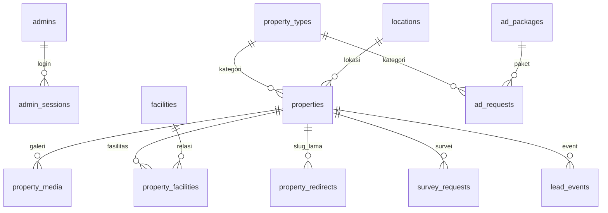

# Database HunianMu

PostgreSQL 16. Tiga migrasi bernomor membentuk 15 tabel aplikasi dan satu tabel pelacak migrasi. Semua FK memakai tipe integer yang sama. Harga disimpan bigint Rupiah tanpa floating point. Waktu disimpan timestamptz dan ditampilkan WIB.

`properties`: data publik dan kolom pemilik internal. Query publik tidak memakai `SELECT p.*`. Status publikasi Draf/Terbit/Arsip berbeda dari ketersediaan Tersedia/Dipesan/Terisi. `deleted_at` adalah soft delete. Kode HM diperoleh sequence PostgreSQL; slug unik dan riwayat perubahan menghasilkan 301. Slug lama listing lain tidak dapat diambil.

`property_media`: jalur tiga ukuran WebP, urutan, alt, dimensi, dan satu cover per listing (partial unique index). Duplikasi listing berbagi berkas foto yang immutable, dengan relasi galeri terpisah.

`ad_requests`, `survey_requests`: nomor kontak, status dan catatan internal. Token acak 256 bit digunakan untuk membawa konteks setelah penyimpanan; tidak ada endpoint publik yang mengembalikan pengajuan. Query token hanya dipakai server untuk menyusun WhatsApp. Token tidak dicatat dalam log URL dan respons redirect memakai Referrer-Policy no-referrer.

`lead_events`: event klik, pengajuan iklan, pengajuan survei, dan penggunaan filter. Klik memuat property_id bila relevan, halaman asal (path/query), sumber konteks, waktu, utm_source/medium/campaign/term/content. Dashboard mengagregasi klik per listing/sumber.

`site_settings` adalah pasangan kunci/nilai; `content_pages` memuat teks biasa, di-escape saat SSR. Sesi dienkripsi dalam cookie dan memiliki ID yang diverifikasi terhadap `admin_sessions`; logout mencabut sesi database, termasuk jika cookie lama diputar ulang. Durasi maksimum 8 jam. Pembersihan berkala sesi kedaluwarsa dapat memakai `DELETE FROM admin_sessions WHERE expires_at < now()`.

Indeks katalog pada status/type/location/price, indeks teks simple PostgreSQL, unique code/slug, dan indeks waktu lead_events tersedia. Pencarian MVP memakai ILIKE berparameter pada judul, deskripsi, alamat umum dan nama lokasi; wildcard input di-escape. Bila dataset bertambah, gunakan indeks trigram atau full-text berdasarkan profil query nyata.
